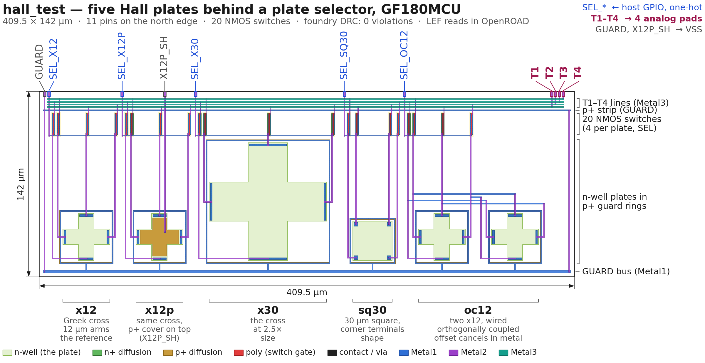

# hall_test — five Hall plates with a plate selector

Analog test cell from Andrew Wingate (anfroholic): **five Hall-effect plates**
in n-well and a **5-way selector** (20 thick-oxide NMOS switches). The CPU
raises one `SEL_*` line; that plate's four terminals appear on `T1..T4`, which
go to four analog pads. Bias, spinning and amplification happen on the bench.

**409.5 × 142 µm, 11 pins, all Metal2 on the north edge. No power pins, no
standard cells. Foundry DRC clean (gf180mcuD KLayout deck, `all,-density`:
0 violations). LEF reads in OpenROAD.**



## Views

| file | what |
|---|---|
| `gds/hall_test.gds` | layout |
| `lef/hall_test.lef` | abstract — 11 pins, OBS Metal1–Metal3 over the whole cell |
| `lib/hall_test.lib` | stub Liberty (no arcs, zero capacitance), same form as `r2r_dac` |
| `verilog/hall_test.v` | blackbox |
| `hall_test_pins.md` | pin coordinates and roles |
| `hall_cfg.py` · `gen_hall_layout.py` | the generator (`pip install klayout`, `python3 gen_hall_layout.py` writes GDS/LEF/Verilog next to itself) |
| `bench.md` | what gets measured and how |

## Pins (west → east)

| pin | connect to | what it is |
|---|---|---|
| `GUARD` | VSS | p+ guard rings and strips — substrate reference |
| `SEL_X12` `SEL_X12P` `SEL_X30` `SEL_SQ30` `SEL_OC12` | 5 GPIO / register bits | plate select, **one-hot, active high**. All low = nothing connected, safe at reset |
| `X12P_SH` | VSS (or a pad, optional) | p+ cover of the `x12p` plate |
| `T1` `T2` `T3` `T4` | **4 analog pads** | selected plate's N / E / S / W terminals |

The `SEL_*` gates are `nfet_06v0`, so 3.3 V or 5 V logic both work. Analog
nodes stay between VSS and VSS + 3.3 V.

## Integration notes

- Instantiate without `VDD`/`VSS` ports — the cell has none.
- `T1..T4` need analog pads (`apad`/`asig_5p0`), not `bi_24t` — the Hall
  signal is millivolts and must not pass through a digital driver/clamp.
- Any orientation. A mirrored instance flips the Hall sign; please note the
  orientation used.
- Please keep PDN straps and high-current metal off Metal4/Metal5 above the
  cell where the flow allows (a 10 mA strap 10 µm above puts ~0.2 mT on a
  plate). The LEF already blocks Metal1–3.
- **LVS:** treat as a blackbox. Each plate's four terminals are n+ taps into
  one n-well and extract as one net — that is the device.

`config.yaml` `MACROS` entry, in the style of the other analog cells
(location is a placeholder):

```yaml
  hall_test:
    gds:
      - dir::../macros/Analog/hall_test/gds/hall_test.gds
    lef:
      - dir::../macros/Analog/hall_test/lef/hall_test.lef
    vh:
      - dir::../macros/Analog/hall_test/verilog/hall_test.v
    lib:
      "*":
        - dir::../macros/Analog/hall_test/lib/hall_test.lib
    instances:
      hall_test:
        location: [X, Y]
        orientation: N
```

Instance in `chip_top.sv`:

`GUARD` and `X12P_SH` carry only leakage and the substrate is already VSS,
so a tie-low cell is enough; a direct VSS hookup through the PDN is better if
it is easy in this flow.

```verilog
(* keep *)
hall_test hall_test (
	.GUARD   (1'b0),
	.X12P_SH (1'b0),
	.SEL_X12 (...),
	.SEL_X12P(...),
	.SEL_X30 (...),
	.SEL_SQ30(...),
	.SEL_OC12(...),
	.T1      (...),
	.T2      (...),
	.T3      (...),
	.T4      (...)
);
```
